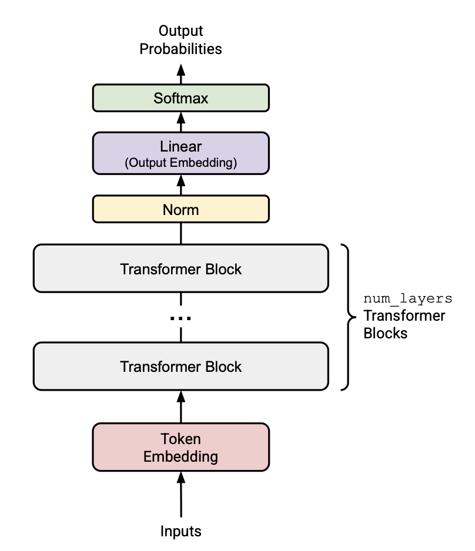

# NanoLM

A (not large) language model built from scratch, following [Stanford's CS336 course](#resources): the tokenizer, the Transformer, the training loop and text generation are all written by hand, without PyTorch's ready-made layers.

The repo is meant as study material for learning how a language model works. Each section below explains one concept, why it is needed and how it fits with the others. The [interactive walkthroughs](https://j4nn0.github.io/nanolm/) show the same ideas step by step, using the real numbers from this model.

The model is trained on TinyStories, a collection of short, simple stories for children:

- 22.7 million parameters, the numbers the model learns;
- A vocabulary of 10,000 tokens;
- About 70 minutes of training on an Apple M5 laptop, reading about 41 million pieces;
- A validation loss of 1.66 on stories it has never seen: on average, it gives the correct next piece about a 1-in-5 chance, out of 10,000 options.

A story it wrote, starting from "Once upon a time":

> Once upon a time, in a small town, there lived a little boy named Tim. Tim was an honest boy who always told the truth. [...] But then, Tim saw a big box near the road. He wanted to open it, but it was too high for him. He tried to jump and reach the box, but he couldn't. Tim was sad and started to cry.
>
> His mom heard him cry and came to help. She said, "Tim, you should not be so stubborn. Let's go inside and find a grown-up to help you." Tim learned that it is important to listen to his mom and stay close to home.

## Table of Contents

- [Usage](#usage)
  - [Run the Pipeline](#run-the-pipeline)
  - [Train the Model](#train-the-model)
  - [Generate Text](#generate-text)
  - [Steer Generation](#steer-generation)
  - [Profile the Tokenizer](#profile-the-tokenizer)
- [Datasets](#datasets)
- [BPE Tokenizer](#bpe-tokenizer)
  - [Pre-tokenization](#pre-tokenization)
  - [BPE Training](#bpe-training)
  - [Encoding](#encoding)
  - [Decoding](#decoding)
  - [Optimizations](#optimizations)
- [Transformer](#transformer)
  - [Embedding Module](#embedding-module)
  - [Linear Module](#linear-module)
  - [Root Mean Square Layer Normalization](#root-mean-square-layer-normalization)
  - [SwiGLU Feed-Forward Network](#swiglu-feed-forward-network)
  - [Rotary Positional Embedding](#rotary-positional-embedding)
  - [Softmax](#softmax)
  - [Scaled Dot-Product Attention](#scaled-dot-product-attention)
  - [Causal Multi-Head Self-Attention](#causal-multi-head-self-attention)
  - [Transformer Block](#transformer-block)
  - [Transformer Language Model](#transformer-language-model)
- [Training](#training)
  - [Cross-Entropy Loss](#cross-entropy-loss)
  - [AdamW Optimizer](#adamw-optimizer)
  - [Learning Rate Schedule](#learning-rate-schedule)
  - [Gradient Clipping](#gradient-clipping)
  - [Data Loading](#data-loading)
  - [Checkpointing](#checkpointing)
  - [Training Loop](#training-loop)
- [Text Generation](#text-generation)
  - [Sampling](#sampling)
  - [Temperature](#temperature)
  - [Top-p Sampling](#top-p-sampling)
- [Steering](#steering)
  - [Residual Stream](#residual-stream)
  - [Steering Vector](#steering-vector)
  - [Adding the Vector](#adding-the-vector)
  - [Results](#results)
  - [Other Approaches](#other-approaches)
- [Putting It Together](#putting-it-together)
- [Resources](#resources)

## Usage

Install dependencies:
```shell
uv sync
```

Download TinyStories first (see [Datasets](#datasets)).

### Run the Pipeline

Run every stage, from raw text to a trained model:
```shell
uv run python -m nanolm
```

This runs every stage on TinyStories:

1. Train a BPE tokenizer with a vocabulary of 10,000 tokens (saved to `tokenizers/<dataset>_<vocab size>.json`).
2. Encode the training and validation text into token IDs (saved to `data/<dataset>-train_<vocab size>.bin` and `data/<dataset>-valid_<vocab size>.bin`).
3. Train the language model, printing the training and validation loss and saving checkpoints (to `checkpoints/<dataset>_<vocab size>.pt`).
4. Generate a short story from the trained model.

The settings of every stage, such as the vocabulary size, the model size, the learning rate and the number of training steps, are in `src/nanolm/config.py`. The training, generation and steering commands read them from there too, so a change made there applies to all of them.

### Train the Model

To run only the training, for example after changing a setting, use the token IDs that the pipeline has already encoded:
```shell
uv run python -m nanolm.training
```

The model is saved to `checkpoints/TinyStoriesV2-GPT4_10000.pt` every 1,000 steps and at the end of training. If that file already exists, training continues from it, so an interrupted run picks up where it stopped. A finished model is not trained further.

To train a new model and keep the previous one, save it to another file:
```shell
uv run python -m nanolm.training --checkpoint-path checkpoints/experiment.pt
```

Run the same command again to continue it. Generation and steering load the checkpoint set in `src/nanolm/config.py`, so set it there to use this model.

### Generate Text

Once the model is trained, give it the beginning of a story and it writes the rest:
```shell
uv run python -m nanolm.generation --prompt "Once upon a time, there was a little"
```

The model is not a chatbot. It has only seen short children's stories, so it continues the prompt as one; it does not answer questions or follow instructions. Prompts that sound like the start or middle of a story work best.

The options that change the output:

| Option | Default | Effect |
|---|---|---|
| `--prompt` | (required) | The text the model continues. |
| `--temperature` | `1.0` | Lower values give safer, more repetitive text; higher values give more varied text with more mistakes (see [Temperature](#temperature)). |
| `--top-p` | `1.0` | Keeps only the most likely tokens whose probabilities add up to this value (see [Top-p Sampling](#top-p-sampling)). |
| `--max-new-tokens` | `256` | Stops after this many new tokens, if the model has not ended the story before. |
| `--seed` | none | Makes sampling repeatable: the same seed and prompt give the same text. |
| `--device` | best available | `cuda`, `mps` or `cpu`. |

Generation stops early when the model produces `<|endoftext|>`, which marks the end of a story.

### Steer Generation

To push the stories towards a topic without retraining, name the topic:
```shell
uv run python -m nanolm.steering \
  --prompt "Once upon a time, there was a little" \
  --toward "dragon"
```

Without steering, the model continues this prompt with a dragon in none of 64 stories. With this command, 73% of the stories are about a dragon.

The steering options:

| Option | Default | Effect |
|---|---|---|
| `--toward` | (required) | A word or text with the concept to steer towards. A single word is read as it appears inside a story, with a space before it. |
| `--away-from` | none | A word or text with the concept to steer away from. Only the difference between the two is used, which gives a cleaner direction. Without it, the whole vector of `--toward` is added. |
| `--layer` | `1` | The block after which the steering is added, counted from 1. Earlier blocks steer better in this model. |
| `--strength` | `1.0` | How much of the steering to add; `0` turns it off. Too much breaks the text. |
| `--every-position` | off | Steers every new token too, not only the prompt. The push is stronger but never stops, so the text gets repetitive; use a lower strength, such as `0.5`. |
| `--compare` | off | Also prints each story without steering, with the same seed, so the steering is the only difference between the two. |
| `--num-samples` | `1` | How many stories to write. They use consecutive seeds, starting at `--seed`. |

The other options (`--prompt`, `--temperature`, `--top-p`, `--max-new-tokens`, `--seed`, `--device`) work as in [Generate Text](#generate-text), except that sampling defaults to a temperature of `0.7` and top-p of `0.9`, and `--seed` defaults to `0`, so the same command always writes the same stories.

A full example, which steers from girl towards dragon and prints three stories, each with and without steering:
```shell
uv run python -m nanolm.steering \
  --prompt "Once upon a time, there was a little" \
  --toward "dragon" \
  --away-from "girl" \
  --layer 1 \
  --strength 1.0 \
  --temperature 0.7 \
  --top-p 0.9 \
  --max-new-tokens 80 \
  --num-samples 3 \
  --seed 0 \
  --compare
```

Steering away from girl makes the direction cleaner: 89% of the stories are about a dragon instead of 73%. See [Steering](#steering) for how it works.

### Profile the Tokenizer

To see where tokenizer training spends its time:
```shell
uv run python -m nanolm.profiling
```

By default, it trains a vocabulary of 1,000 tokens on the TinyStories validation text, prints the slowest functions, and saves the profile to `profiles/` (see [Optimizations](#optimizations)). Use `--input-path` and `--vocab-size` to profile a different file or vocabulary size.

## Datasets

Using two pre-processed datasets, i.e., [TinyStories](https://huggingface.co/datasets/roneneldan/TinyStories) and [OpenWebText](https://huggingface.co/datasets/stanford-cs336/owt-sample).

Create `data` folder if it doesn't exist:
```shell
mkdir -p data
cd data
```

Download the TinyStories data:
```shell
wget https://huggingface.co/datasets/roneneldan/TinyStories/resolve/main/TinyStoriesV2-GPT4-train.txt
wget https://huggingface.co/datasets/roneneldan/TinyStories/resolve/main/TinyStoriesV2-GPT4-valid.txt
```

Download a subsample of OpenWebText:
```shell
wget https://huggingface.co/datasets/stanford-cs336/owt-sample/resolve/main/owt_train.txt.gz
gunzip owt_train.txt.gz
wget https://huggingface.co/datasets/stanford-cs336/owt-sample/resolve/main/owt_valid.txt.gz
gunzip owt_valid.txt.gz
```

## BPE Tokenizer

Tokenization turns text into a sequence of integers (numbers). There are several ways to cut text into tokens. In this repo, we will train and implement a byte-level byte-pair encoding (BPE). Later, we will use this tokenizer to encode text into tokens for language modeling.

### Pre-tokenization

Before deriving any BPE merges, we split the raw text into chunks called *pre-tokens* (words, numbers, punctuation runs, spaces) using the same [regex pattern GPT-2 uses](https://github.com/openai/tiktoken/pull/234/changes). This is done for two reasons:

- **Efficiency**: rather than performing the merge operation (iterative loop) on the entire text corpus, we condense this into a frequency distribution of unique pre-tokens in order to save memory space. This is an improvement in the hundreds of times factor since unique words increase much slower than all text.

    Imagine the following corpus:
    ```
    low low low low low lower lower newest newest newest widest widest
    ```
    
    That's 12 pre-tokens which could be collapsed to something like this:
    ```python
    pretoken_counts = {"low": 5, "lower": 2, "newest": 3, "widest": 2}
    ```
    
    This is now only 4 entries. To count the pair `l - o` we don't need to iterate trough 12 words, but just 4 and multiply:
    ```
    "low"   -> contains "l - o" -> +5
    "lower" -> contains "l - o" -> +2
                                  = 7
    ```
    
    This leads to an identical result with a third of the work.

- **Boundaries**: the merging process occurs within a pre-token and goes no further than that. Hence, the word cannot be joined to the word after it, or even to the comma following it. It is also this which enables the first rule to function since all occurrences of the word can be considered one entry because they are all tokenized alike regardless of context.

    Imagine the following corpus:
    ```
    the cat the cat the cat the dog
    ```
  
    Without pre-tokenization this is just one stream of characters, and the space is treated no differently than any other character:
    ```
    t - h     -> th
    th - e    -> the
    the - ␣   -> the␣
    c - a     -> ca
    ca - t    -> cat
    the␣- cat -> the␣cat
    ```

    The word `cat` is now tokenized one way after `the` and another way elsewhere. With pre-tokenization, the corpus is cut into pieces first:

    ```python 
    {"the": 4, "␣cat": 3, "␣dog": 1}
    ```
  
    The token `the␣cat` cannot be formed because no entry contains both words, so the pair is never counted.

### BPE Training

The tokenizer vocabulary is a one-to-one mapping between byte-string tokens and integer IDs. Since this is a byte-level BPE tokenizer, its initial vocabulary contains every possible byte value. There are 256 values (`0` through `255`), so training always starts with 256 byte tokens, followed by any supplied special tokens.

You decide in advance how large the vocabulary should ultimately be. The 256 initial byte tokens and any special tokens occupy part of that total; each learned merge adds one more token. For a final size of 260 with one special token, the initial 257 tokens leave room for three learned merges: `260 - 256 - 1 = 3`. Training can also stop naturally when no adjacent pairs remain to merge.

Each pre-token is encoded as UTF-8 and split into one-byte symbols. A pre-token such as `"cat"` begins as:

```
c - a - t
```

It cannot start as the single symbol `cat`, because BPE needs separately addressable adjacent symbols to learn which parts should be combined.

Imagine the pre-token counts are:

```python
pretoken_counts = {
    "cat": 2,
    "car": 1,
}
```

Initially, each word is split into individual bytes:

```python
words = {
    "cat": [b"c", b"a", b"t"], # frequency 2
    "car": [b"c", b"a", b"r"], # frequency 1
}
```

The trainer counts every adjacent pair, weighted by how often its word appeared:

```python
(b"c", b"a")  # occurs in "cat" twice and "car" once -> 2 + 1 = 3
(b"a", b"t")  # occurs in "cat" twice -> 2
(b"a", b"r")  # occurs in "car" -> 1
```

Pair counts are stored by pair, so all occurrences of `(b"c", b"a")` contribute to one total rather than becoming duplicate entries. The most  frequent pair is `(b"c", b"a")`, so BPE adds `ca` to the vocabulary with the next available ID and records the merge. It then applies that merge to every pre-token:

```python
words = {
    "cat": [b"ca", b"t"], # frequency 2
    "car": [b"ca", b"r"], # frequency 1
}
```

On the next iteration, the pairs are `(b"ca", b"t")` with count `2` and `(b"ca", b"r")` with count `1`, so it would learn `b"cat"` next. 

This repeats until the requested final vocabulary size is reached, or there are no pairs left to merge. If two pairs have the same frequency, the code deterministically chooses the lexicographically greater byte pair.

### Encoding

Training the tokenizer produces a vocabulary and an ordered list of merges which can be used to turn new text into token IDs. The language model only reads token IDs, so the training and validation text are encoded once before the model is trained, and a prompt is encoded before the model can continue it.

Encoding repeats the steps of training on the new text, but instead of choosing merges it replays the learned ones. Imagine these merges were learned, in this order:

```
merge 1:  t - h   -> th    ID 256
merge 2:  th - e  -> the   ID 257
merge 3:  ␣ - c   -> ␣c    ID 258
```

Encoding `"the cat"` takes four steps:

1. Pre-tokenize with the same pattern used in training: `"the"` and `"␣cat"`. As in training, merges never cross from one pre-token to the next.
2. Split each pre-token into bytes: `t - h - e` and `␣ - c - a - t`.
3. Apply the merges in the order they were learned. In each pre-token, the pair that was learned earliest is merged first, until no learned pair is left:
    ```
    t - h - e       -> merge 1 -> th - e      -> merge 2 -> the
    ␣ - c - a - t   -> merge 3 -> ␣c - a - t  -> no learned pair left
    ```
    The order matters: `the` can only form once `th` exists, just as in training.
4. Look up the ID of every resulting token in the vocabulary:
    ```
    "the" -> 257    "␣c" -> 258    "a" -> 97    "t" -> 116

    "the cat" -> [257, 258, 97, 116]
    ```

Special tokens such as `<|endoftext|>` are found before pre-tokenization. They are never split and become their own single ID.

A pre-token always encodes to the same IDs, wherever it appears. Each distinct pre-token is therefore encoded once and its IDs are remembered, so frequent words such as `"␣the"` cost a single lookup after their first occurrence.

A whole dataset is too large to encode in one go. The TinyStories training text is 2.2 GB and becomes about half a billion token IDs, and kept in memory as a list of Python numbers they would take tens of gigabytes. The file is therefore split into pieces of about 50 MB, each ending at an `<|endoftext|>` token, so no word is cut in two. The pieces are encoded in parallel, and the IDs of each piece are written to disk in file order as 2-byte numbers, which hold any ID up to 65,535. Only a few pieces are in memory at any time, and the resulting file is about 1 GB.

### Decoding

Decoding turns token IDs back into text, which is needed to read what the model generates. Every ID is looked up in the vocabulary, the bytes of all tokens are joined in order, and the joined bytes are read as UTF-8 text:

```
[257, 258, 97, 116] -> "the" + "␣c" + "a" + "t" -> "the cat"
```

A token can hold only part of a character: `é` is two bytes, and a merge may never have joined them. Joining all the bytes first keeps such a character whole. A sequence that is not valid UTF-8, such as one byte of `é` on its own, can still come out of the model, so it is shown as the replacement character `�` instead of stopping with an error.

### Optimizations

BPE training repeatedly finds the most frequent adjacent pair and merges it. The trainer keeps the information needed for that decision up to date as merges are learned, which keeps each iteration focused on the affected pre-tokens and pairs.

Take this corpus (spaces ignored for simplicity):

```python
pretoken_counts = {"low": 5, "lower": 2, "widest": 3, "newest": 6}
```

Every merge decision depends on pair counts over the whole corpus. Computing them from the raw text would mean walking through every occurrence of every word, again and again. Instead, as described in [Pre-tokenization](#pre-tokenization), the trainer stores each distinct pre-token once together with its frequency, and counts each of its pairs once, weighted by that frequency. Building this table still requires one full pass over the file, so the file is split into chunks at `<|endoftext|>` boundaries, and a pool of worker processes pre-tokenizes those chunks concurrently, with each worker handling one chunk at a time.

After each merge, the pair counts must reflect the new symbol sequences. The straightforward approach is to recount every pair in every pre-token, even though a single merge only changes the few pre-tokens that contain the merged pair. Instead, the trainer computes the counts once, before the first merge, and then keeps them up to date. Alongside the weighted count of every adjacent pair, it records the pre-tokens that contain it. For example, the pair `s - t` occurs nine times: three in `widest` and six in `newest`. A reverse lookup associates that pair with those two pre-tokens:

```
s - t: 9 occurrences
s - t appears in: widest, newest
```

When `s - t` becomes `st`, the reverse lookup shows that only `widest` and `newest` need to be revisited, while `low` and `lower` are left untouched. Their previous pair contributions are removed, their symbol sequences are updated, and their new pair contributions are added. The cost of a merge therefore depends on how many pre-tokens contain the chosen pair, rather than on the size of the corpus.

With the counts kept up to date, each iteration still has to select the pair with the highest count. Scanning the pair counts gives the right answer, but it visits every distinct pair on every merge, and that number keeps growing as new tokens form new pairs: on OpenWebText it reaches 3.2M. Instead, pair counts are also stored in a max-heap, ordered first by count and then by byte pair to break ties deterministically, so the most frequent current candidate is always available at the top of the heap.

Updating the heap on every count change would bring back much of that cost, so the heap is maintained lazily. A decreased count is only corrected when its entry reaches the top. After merging `s - t`, the heap can still contain `e - s` with a priority of 9 even though its current count is 0. When that entry reaches the top, its priority is checked against the current count: stale entries are discarded, and pairs that still occur are added back with their updated count. An increased count, on the other hand, is added immediately. Only pairs adjacent to the newly created token can gain occurrences, so only those are pushed. In this example, `e - st` is pushed with a count of 9 and becomes the next merge, `est`.

As a result, each pair retains a heap entry whose priority is at least its current count. Once the priority at the top matches the current count, it identifies the most frequent pair, and selecting that pair costs O(log n) on average.

Training performance with the `<|endoftext|>` special token, on a 10-core Apple Silicon machine (Python 3.9), with pre-tokenization running on 10 processes:

| Dataset | Vocab size | Pre-tokenization | Unique pre-tokens | Pair-statistics setup | Pair selection | Pair merging | Total |
|---|---|---|---|---|---|---|---|
| TinyStories train (2.2 GB) | 10,000 | 24 s | 60K | 0.1 s | 0.03 s | 1.2 s | ~26 s |
| OpenWebText train (11.9 GB) | 32,000 | 123 s | 6.6M | 24 s | 0.6 s | 375 s | ~523 s |

Picking the best pair is now negligible. On OpenWebText, most of the time is spent applying merges, because the first merges combine very common byte pairs that appear in a large share of all pre-tokens.

These measurements can be reproduced with the `nanolm.profiling` package, which trains the tokenizer under [cProfile](https://docs.python.org/3/library/profile.html) and prints a breakdown of the time spent in each step:
```shell
uv run python -m nanolm.profiling --input-path data/TinyStoriesV2-GPT4-train.txt --vocab-size 10000 --num-processes 10
uv run python -m nanolm.profiling --input-path data/owt_train.txt --vocab-size 32000 --num-processes 10
```

cProfile only observes the main process, so with more than one process the pre-tokenization workers do not appear individually; their total wall time is still reported under `pretokenize_file`. The full profile is saved to `profiles/train.prof` and can be explored with `uvx snakeviz profiles/train.prof`.

## Transformer

The tokenizer gives us token IDs, but a Transformer language model needs vectors it can work with. An embedding turns each ID into a vector. Transformer blocks then let tokens draw on earlier tokens and process what they find. Finally, a linear layer produces a score (a *logit*) for each possible next token. The diagram shows this path.



### Embedding Module

An ID on its own carries no meaning: token `1820` is not "closer" to `1821` than to `5`. An embedding gives every token a learned vector of `d_model` numbers. It is a lookup table with one row per vocabulary token, and each ID selects its row:

```
weight: (vocab_size, d_model)

token ID 1820 -> weight[1820] -> [0.12, -0.53, ..., 0.08]
```

A sequence of IDs becomes a sequence of vectors:

```
token_ids: (batch, seq_len)
output:    (batch, seq_len, d_model)
```

Training changes these vectors along with the rest of the model, letting it represent useful relationships between tokens.

The table starts with random values centered on zero, with standard deviation `1` and values limited to `−3` through `3`. Each lookup returns one stored row; it does not sum values from multiple rows.

### Linear Module

The model repeatedly needs to turn one set of features into another. A linear layer does this with a learned weight matrix $W$. For an input vector $x$ of size `d_in`, it produces an output $y$ of size `d_out`:

$$y = Wx$$

Each output is a weighted sum of the inputs. Training adjusts those weights to make the resulting features useful.

Transformers use linear layers throughout the model. Attention uses them to create queries, keys, and values. The feed-forward network uses them to expand and then shrink each token vector. The final linear layer produces one score, called a logit, for each token in the vocabulary.

Some linear layers also add a learned bias, $y = Wx + b$. This implementation, like LLaMA, uses no bias.

In practice, inputs are stored as rows with the feature dimension last, so the layer computes $y = xW^T$:

```
x:   (batch, seq_len, d_in)
W^T: (d_in, d_out)
y:   (batch, seq_len, d_out)
```

The weights start as small random numbers centered on zero. Their scale depends on the input and output sizes:

$$\sigma = \sqrt{\frac{2}{d_{in} + d_{out}}}$$

Smaller starting weights help keep outputs at a useful scale when a layer combines many inputs.

### Root Mean Square Layer Normalization

As token vectors pass through blocks, their values can grow or shrink. Normalization keeps their scale more consistent, making the next layer easier to train. A block applies it before attention and before the feed-forward network.

Root Mean Square Layer Normalization (RMSNorm) divides each token vector $a$ of size `d_model` by its root mean square, then multiplies it by a learned gain $g$:

$$\text{RMSNorm}(a_i) = \frac{a_i}{\text{RMS}(a)} \, g_i  \qquad  \text{RMS}(a) = \sqrt{\frac{1}{d_{model}} \sum_{i=1}^{d_{model}} a_i^2 + \varepsilon}$$

For example, with $\varepsilon$ ignored:

```
a      = [3, -4, 0, 12]
RMS(a) = sqrt((9 + 16 + 0 + 144) / 4) = 6.5
a/RMS  = [0.46, -0.62, 0, 1.85]   (RMS = 1)
```

Dividing by the RMS changes the vector's overall size while preserving its direction. The learned gain $g$ then lets the model adjust each dimension separately; it starts at `1`. The small constant $\varepsilon$ (`1e-5`) prevents division by zero. Each token is normalized using only its own `d_model` values.

RMSNorm is simpler than LayerNorm: it does not subtract the mean or add a learned bias. That makes it cheaper to compute while still keeping the vector scale under control.

### SwiGLU Feed-Forward Network

Attention brings information from other tokens into each token's vector. A feed-forward network (FFN) then works on each token separately. It expands the vector from `d_model` to a wider `d_ff`, transforms it, and projects it back to `d_model`.

This middle transformation needs a nonlinearity. Otherwise, two linear layers in a row would behave like one: $W_2(W_1x) = (W_2W_1)x$.

SwiGLU uses the smooth activation function SiLU (also called Swish):

$$\text{SiLU}(x) = x \cdot \sigma(x) = \frac{x}{1 + e^{-x}}$$

For large positive inputs, SiLU is close to $x$; for large negative inputs, it approaches `0`. Its smooth transition around zero also makes it useful during training.

```
x       = [-4,    -1,    0,  1,    4   ]
SiLU(x) = [-0.07, -0.27, 0,  0.73, 3.93]
```

SwiGLU also uses a gate. It makes two projections of the input, passes one through SiLU, and multiplies them value by value. The SiLU branch controls how much of the other branch passes through:

$$\text{FFN}(x) = W_2\big(\text{SiLU}(W_1x) \odot W_3x\big)$$

where $\odot$ is element-wise multiplication. $W_1$ and $W_3$ have shape `(d_ff, d_model)`, and $W_2$ has shape `(d_model, d_ff)`:

```
x:                (batch, seq_len, d_model)
SiLU(W1 x), W3 x: (batch, seq_len, d_ff)
gate * value:     (batch, seq_len, d_ff)
W2 (...):         (batch, seq_len, d_model)
```

Because the gate depends on the input, different tokens can emphasize different features. The final projection brings the result back to `d_model`.

SwiGLU uses three matrices instead of the two in a basic FFN. To keep their parameter counts similar, `d_ff` is about $\frac{8}{3} \cdot d_{model}$ instead of $4 \cdot d_{model}$, rounded to a multiple of 64. For $d_{model} = 512$:

```
classic: 2 × 512 × 2048 = 2,097,152 parameters
SwiGLU:  3 × 512 × 1344 = 2,064,384 parameters
```

### Rotary Positional Embedding

Attention compares tokens, but those comparisons alone do not tell it where a token appears. Word order matters: `dog bites man` and `man bites dog` mean different things. The model therefore needs a way to include position.

Rotary Positional Embedding (RoPE) adds position when attention compares tokens. It splits each query and key vector into pairs of values and rotates each pair by an angle based on its position. For a vector of size `d_k`:

$$\begin{pmatrix} x'_{2k} \\ x'_{2k+1} \end{pmatrix} = \begin{pmatrix} \cos\theta_{i,k} & -\sin\theta_{i,k} \\ \sin\theta_{i,k} & \cos\theta_{i,k} \end{pmatrix} \begin{pmatrix} x_{2k} \\ x_{2k+1} \end{pmatrix} \qquad \theta_{i,k} = i \cdot \Theta^{-2k/d_k}$$

where $i$ is the token's position, $k = 0, \dots, d_k/2 - 1$ is the index of the pair, and $\Theta$ is a constant, usually `10000`.

Each pair rotates at a different speed, so the rotations capture both short and long distances. For example:

```
d_k = 8, Θ = 10000

pair k:            0      1      2      3
angle per step:    1      0.1    0.01   0.001   (radians)
```

The useful property of rotation appears when attention compares a query $q$ at position $m$ with a key $k$ at position $n$. Their dot product depends on the distance between those positions:

$$\langle R_m q, R_n k \rangle = \langle q, R_{n-m} k \rangle$$

For the same query and key vectors, positions `5` and `2` give the same score as positions `20` and `17`: in both cases the key is three tokens earlier. This lets attention use relative position.

RoPE has no learned parameters. The implementation computes the sines and cosines up to the maximum sequence length once, then looks them up for each token.

### Softmax

Attention needs to turn its match scores into weights that add up to one. The model can also use the same operation to turn next-token logits into probabilities. That operation is softmax:

$$\text{softmax}(x)_i = \frac{e^{x_i}}{\sum_j e^{x_j}}$$

Every output is between `0` and `1`, and they sum to `1`. The exponential makes all values positive and preserves their order, and it amplifies differences: a score `1` higher gets about `2.7` times more probability.

```
x          = [2,    1,    0   ]
softmax(x) = [0.67, 0.24, 0.09]
```

The largest score gets the largest share, but the others still contribute. A score of $-\infty$ gets a weight of `0`, which attention uses to hide tokens it must not see.

Applied to a tensor, softmax normalizes along one dimension, independently for every other position. For attention scores of shape `(batch, seq_len, seq_len)`, normalizing along the last dimension gives each query a distribution over the keys.

There is one practical issue: exponentials grow quickly, so $e^{1000}$ overflows. We can subtract the same constant $c$ from every score without changing softmax, because that factor cancels:

$$\frac{e^{x_i - c}}{\sum_j e^{x_j - c}} = \frac{e^{-c} \, e^{x_i}}{e^{-c} \sum_j e^{x_j}} = \frac{e^{x_i}}{\sum_j e^{x_j}}$$

Choosing $c = \max(x)$ keeps every exponent at or below `1`:

```
x            = [1000, 1001, 1002]
naive        = [nan,  nan,  nan ]
x - max(x)   = [-2,   -1,   0   ]
softmax(x)   = [0.09, 0.24, 0.67]
```

### Scaled Dot-Product Attention

Now we can put linear layers and softmax together. Attention lets a token draw information from other tokens. In `the animal didn't cross the street because it was tired`, for example, the word `it` needs context from `animal`.

Linear layers make three vectors from each token's current representation. Its *query* $q$ describes what it is looking for. Its *key* $k$ helps other tokens decide whether to look at it. Its *value* $v$ carries the information they can draw from it.

Each query is compared with the keys. Softmax turns those match scores into weights, which are used to combine the values:

$$\text{Attention}(Q, K, V) = \text{softmax}\left(\frac{QK^T}{\sqrt{d_k}}\right)V$$

Step by step, for $n$ queries and $m$ keys:

```
Q K^T / sqrt(d_k):  (n, d_k) @ (d_k, m) -> (n, m)    how well each query matches each key
softmax over keys:  (n, m)                           each row sums to 1
@ V:                (n, m) @ (m, d_v)   -> (n, d_v)  one blended value per query
```

For example, if a query's scores against three keys are `[2, 1, 0]`, its weights are `[0.67, 0.24, 0.09]`, and its output is `0.67 v0 + 0.24 v1 + 0.09 v2`: mostly the first token's information, with a little of the others.

The same calculation works across batches and attention heads. The division by $\sqrt{d_k}$ keeps dot products from growing too large as the vectors get wider; otherwise softmax can put nearly all the weight on one key and make training harder.

An optional mask controls which keys a query may use. Masked scores become $-\infty$ before softmax, giving those keys zero weight. The language model uses this to keep tokens from seeing what comes next.

### Causal Multi-Head Self-Attention

In *self-attention*, queries, keys, and values all come from the same sequence. Three learned linear layers project the current token vectors $x$ into those roles:

$$Q = xW_Q^T \qquad K = xW_K^T \qquad V = xW_V^T$$

One set of attention weights gives a token one way to look at the sequence. Several *heads* let it look for different patterns at once, such as a nearby word or a matching bracket. The model splits each `d_model` vector into $h$ heads of size $d_k = d_{model} / h$ and runs attention in each one. It then joins their outputs and mixes them with another linear layer $W_O$:

$$\text{MultiHead}(x) = W_O \, \text{Concat}(\text{head}_1, \dots, \text{head}_h) \qquad \text{head}_i = \text{Attention}(Q_i, K_i, V_i)$$

```
x:                   (batch, seq_len, d_model)
Q, K, V:             (batch, seq_len, d_model)
split into heads:    (batch, h, seq_len, d_k)
attention per head:  (batch, h, seq_len, d_k)
concatenate heads:   (batch, seq_len, d_model)
W_O:                 (batch, seq_len, d_model)
```

Because $h \cdot d_k = d_{model}$, splitting into heads keeps the total vector width the same. RoPE rotates the queries and keys in each head before they are compared. The values stay as they are; position affects which information is selected.

To predict the next token at each position, the model must only use tokens it has already seen. A *causal mask* allows token $i$ to attend to tokens $0, \dots, i$:

```
         keys
         0  1  2  3
query 0  ✓  ✗  ✗  ✗
query 1  ✓  ✓  ✗  ✗
query 2  ✓  ✓  ✓  ✗
query 3  ✓  ✓  ✓  ✓
```

So changing a later token cannot change an earlier output. During training, one sequence of $n$ tokens can provide $n$ next-token predictions in a single pass.

### Transformer Block

A Transformer block combines attention and the SwiGLU feed-forward network. Attention lets each token gather information from earlier tokens; the feed-forward network then processes each token's vector on its own. Each of the two reads a normalized copy of the token vectors and adds its output back to them:

```
x = x + attention(RMSNorm(x))
x = x + SwiGLU(RMSNorm(x))
```

Adding the output back, rather than replacing `x`, is called a *residual connection*. Each part only has to learn a change to the vectors instead of rebuilding them, and during training the gradient can flow straight back through the additions to the first blocks. Normalizing the copy before each part (*pre-norm*) gives attention and SwiGLU inputs of a steady scale, however large `x` itself grows.

### Transformer Language Model

The full model chains the pieces in the order of the diagram:

```
token IDs                  (batch, seq_len)
embedding                  (batch, seq_len, d_model)
num_layers blocks          (batch, seq_len, d_model)
RMSNorm                    (batch, seq_len, d_model)
linear                     (batch, seq_len, vocab_size)   one logit per vocabulary token
```

The blocks keep adding to the same vectors, so the final RMSNorm brings them back to a steady scale before the last linear layer turns each one into logits. The *context length* is the longest sequence the model accepts, and RoPE prepares its rotations for exactly that many positions.

With a vocabulary of 10,000 tokens, `d_model = 512`, 4 blocks, 16 heads, and a SwiGLU hidden size of 1,344, the model has about 22.7 million weights:

```
embedding      10,000 × 512                                5.1 M
4 blocks       4 × (attention 1.0 M + SwiGLU 2.1 M)       12.4 M
output layer   512 × 10,000                                5.1 M
```

## Training

The model starts with random weights, so its predictions are random too. Training improves them by repeating one step over many batches of text (a batch is a group of short snippets of training text, each a few hundred tokens long, taken from random places in the dataset):
1. The model outputs next-token scores at every position.
2. A *loss* function measures the error, i.e., how wrong the next-token predictions are.
3. For every weight, the *gradient* tells which way to move it to lower the loss.
4. The *optimizer* moves every weight a small step in that direction.
5. The *learning rate* schedule and *gradient clipping* control how large those moves are.

The sections below cover the loss, the optimizer, and two ways of controlling how big each step is: the learning rate schedule and gradient clipping. The last three sections cover how batches are drawn from the dataset, how training is saved and resumed, and how all of it runs together.

### Cross-Entropy Loss

At every position, the model outputs one score per vocabulary token, and softmax turns those scores into probabilities. The training text tells us the correct next token. Cross-entropy looks only at the probability the model gave to that token and takes its negative log:

$$\text{loss} = -\log p(\text{correct token})$$

For instance, for the text `"the cat sat on the"` the correct next token is `"mat"`:

```
p("mat") = 0.9  -> loss 0.11   (good)
p("mat") = 0.5  -> loss 0.69
p("mat") = 0.01 -> loss 4.61   (bad)
```

The loss is `0` only when the model is certain of the correct token, and it grows quickly when the model is confident in a wrong one. A batch has thousands of positions, so their losses are averaged into the single number that training tries to push down.

For example, take a small batch of 2 snippets with 4 tokens each, so 8 positions. Each snippet is a row and each column is a position. The target at each position is simply the token that comes next in the text:

```
               position 0   position 1   position 2   position 3
snippet 1
  input        the          cat          sat          on
  target       cat          sat          on           the

snippet 2
  input        once         upon         a            time
  target       upon         a            time         there
```

At each position, the model has read the tokens up to that point and gives a probability to every token in the vocabulary. Only the probability of the correct target is kept. The values below are examples of what a partly trained model might output:

```
snippet 1
  position 0   read "the"                -> p("cat")   = 0.05
  position 1   read "the cat"            -> p("sat")   = 0.30
  position 2   read "the cat sat"        -> p("on")    = 0.60
  position 3   read "the cat sat on"     -> p("the")   = 0.80

snippet 2
  position 0   read "once"               -> p("upon")  = 0.40
  position 1   read "once upon"          -> p("a")     = 0.90
  position 2   read "once upon a"        -> p("time")  = 0.95
  position 3   read "once upon a time"   -> p("there") = 0.20
```

Each probability becomes $-\log p$, for example $-\log 0.05 = 3.00$. The losses form a grid with the same shape as the batch:

```
             pos 0   pos 1   pos 2   pos 3
snippet 1    3.00    1.20    0.51    0.22
snippet 2    0.92    0.11    0.05    1.61
```

All 8 losses are averaged:

```
(3.00 + 1.20 + 0.51 + 0.22 + 0.92 + 0.11 + 0.05 + 1.61) / 8 = 7.62 / 8 = 0.95
```

`0.95` is the loss of this batch, and one training step is taken to lower it. The grid also shows why positions differ:

- **Little context, high loss.** After reading only `"the"`, almost any noun could follow, so the model gives `"cat"` just `0.05`, and that position costs `3.00`.
- **Predictable text, low loss.** After `"once upon a"`, `"time"` is nearly certain (`0.95`), so it costs only `0.05`.
- **Genuinely open text.** After `"once upon a time"`, many words could follow, so even a good model loses something there (`1.61`).

The average counts every position equally, and lowering it improves all 8 predictions together. The next step draws a new random batch with its own average. Since some batches contain harder text than others, the loss goes up and down from step to step even while the model improves; what matters is the trend over many steps.

If a model assigns equal probability to every token in a vocabulary of size $V$, each token has probability $1/V$. Since the loss is the negative $\log$ of the correct token's probability, the loss is $-\log(1/V)=\log V$. In practice, loss is calculated directly from the model's raw scores (logits) to avoid numerical errors. Very small probabilities can round to zero, making $\log 0$ undefined. Subtracting the largest logit before exponentiation keeps the calculation numerically stable without changing the result.

To give the loss an intuitive reading, we define *Perplexity* as $e^{\text{loss}}$, which undoes the $\log$ and turns the loss back into a number of tokens: a model with perplexity $N$ is as unsure as one that chooses evenly among $N$ tokens at every position. With a 10,000-token vocabulary:

```
loss 9.2  -> perplexity ≈ 10,000   as unsure as guessing blindly from the whole vocabulary
loss 4.0  -> perplexity ≈ 55       as unsure as choosing among 55 tokens
loss 1.5  -> perplexity ≈ 4.5      as unsure as choosing among 4 or 5 tokens
loss 0    -> perplexity = 1        always certain of the correct token
```

Loss and perplexity carry the same information on different scales. Training lowers the loss; perplexity makes its value easier to read and is often used to compare models. It is computed from the loss averaged over all positions.

### AdamW Optimizer

From the loss, the model computes a gradient for every weight: how much the loss would rise if that weight were nudged up slightly. Its sign says which way to move the weight:

```
weight w:  gradient +2.0  -> raising w raises the loss -> lower w
weight u:  gradient -0.5  -> raising u lowers the loss -> raise u
```

The gradient does not say how far to move. The simplest optimizer takes a small step against it, scaled by the *learning rate* $\alpha$ (for example `0.001`):

```
new weight = weight - α × gradient
```

This works, but has two problems:

1. **Noise.** Each batch is a small sample of the text, so its gradient points in a slightly different direction from the next batch's.
2. **Scale.** Some weights always get large gradients and others tiny ones, so a single learning rate is too big for some and too small for others.

Adam fixes both by keeping two running averages for every weight:

- `m` averages recent gradients (roughly the last 10 steps). Batch noise mostly cancels out, leaving the direction they agree on.
- `v` averages recent squared gradients (roughly the last 1,000 steps). It measures how large this weight's gradients usually are.

The step is $\alpha \cdot m / \sqrt{v}$. Dividing by $\sqrt{v}$ removes each weight's usual gradient size, so every weight moves by about $\alpha$ per step:

```
weight A: gradients around 100   -> m ≈ 100,  √v ≈ 100   -> step ≈ α
weight B: gradients around 0.01  -> m ≈ 0.01, √v ≈ 0.01  -> step ≈ α
```

Both averages start at `0`, so during the first steps they are too small. Adam scales them up by an amount that fades away as training continues.

The "W" in AdamW is *weight decay*: every step, each weight also shrinks towards zero by a small fixed fraction ($\alpha \cdot \lambda$, for example `0.001 × 0.01`). Weights therefore stay small unless the loss really needs them large, which usually helps the model on text it has not seen. Earlier versions of Adam mixed this shrinking into the gradient, where the division by $\sqrt{v}$ weakened it for weights with large gradients; AdamW keeps it separate so every weight shrinks by the same fraction.

Keeping `m` and `v` for every weight means the optimizer uses twice as much memory as the weights themselves.

### Learning Rate Schedule

The learning rate $\alpha$ sets the size of every step, and the best size changes during training. At the start, the weights are random and Adam's averages are unreliable, so large steps can push the model in a bad direction. Near the end, small steps let it settle on a good solution.

A *cosine schedule with warm-up* changes $\alpha$ at every step in three phases:

1. **Warm-up:** grow evenly from `0` to a maximum, over the first $T_w$ steps.
2. **Cosine decay:** lower it to a minimum by step $T_c$, along half a cosine wave: slowly at first, faster in the middle, and slowly again near the end.
3. **After $T_c$:** stay at the minimum.

```
max = 1.0, min = 0.1, T_w = 10, T_c = 100

step:           0    5    10   55    100   150
learning rate:  0    0.5  1.0  0.55  0.1   0.1
```

### Gradient Clipping

Occasionally an unusual batch produces a very large gradient, and one step along it can undo much of what the model has learned. Gradient clipping limits how large the gradient can be.

It measures the size of all the gradients together, as the length of one long vector made from every weight's gradient. If that length is above a maximum, every gradient is scaled down by the same factor so the length equals the maximum. Otherwise the gradients are left unchanged.

```
maximum length = 1.0

gradients [3, 4]      length 5.0  -> scaled by 1/5 -> [0.6, 0.8]   length 1.0
gradients [0.3, 0.4]  length 0.5  -> unchanged
```

Because every gradient is scaled by the same factor, the step gets shorter but keeps its direction.

### Data Loading

Before training, the whole dataset is tokenized once and stored as one long list of token IDs. Document boundaries are marked by a special token such as `<|endoftext|>`, so the list needs no other structure.

A batch is made by picking `batch_size` random start positions in that list and cutting `context_length` tokens from each one. The targets are the same snippet shifted one token to the right, so at every position the target is the token that comes next:

```
token IDs:  ...  12   845   31   907   2   ...
                 ^ start, context_length = 4

input:           12   845   31   907
target:          845  31    907  2
```

The last input token still needs a target, so every snippet uses `context_length + 1` tokens, and a start can be at most `context_length + 1` tokens before the end of the list. Random starts mean every step sees a different mix of text, and over many steps every part of the dataset is used.

Datasets can be larger than the available memory: the OpenWebText sample is about 11 GB of text. The token file is therefore *memory-mapped*: the program uses it as if it were an array in memory, but the operating system reads from disk only the parts that are accessed, i.e., the snippets of each batch.

### Checkpointing

Training can take hours, and an interruption would lose all the progress. A *checkpoint* is a file with everything needed to continue as if training had never stopped:

- the model's weights;
- the optimizer's state: `m` and `v` for every weight, and the number of steps already taken;
- the iteration number, which also sets where the learning rate schedule continues.

The weights alone are enough to use the trained model, but not to continue training it. Without the optimizer state, `m` and `v` would restart from zero and Adam would take its first, unreliable steps again; without the iteration number, the schedule would restart its warm-up from a learning rate of `0`.

### Training Loop

The training loop repeats one step, combining every piece above:

1. Set the learning rate for this step from the schedule.
2. Draw a random batch of inputs and targets.
3. Compute the logits and the cross-entropy loss.
4. Compute the gradient of every weight. Gradients from the previous step are cleared first, otherwise the new ones would be added to them.
5. Clip the gradients.
6. Let AdamW update every weight.

At regular intervals the loop also prints the training loss, measures the *validation loss*, and saves a checkpoint.

The validation loss is measured on text the model never trains on. The training loss can keep falling just because the model memorizes its training text; the validation loss shows how well it predicts new text. If the training loss keeps falling while the validation loss rises, the model is memorizing (*overfitting*). The validation loss is averaged over several batches, so it is less noisy than the training loss of a single batch, and it needs no gradients, since no weight is updated.

For example, with every byte used as its own token (a vocabulary of 256, so a random model starts at $\log 256 \approx 5.55$), a small model with 470,000 weights trained on TinyStories for 300 steps:

```
step 50/300  | train loss 2.1345 | lr 2.96e-03
step 150/300 | train loss 1.5277 | lr 1.82e-03
step 150/300 | validation loss 1.5142
step 300/300 | train loss 1.3788 | lr 1.00e-04
step 300/300 | validation loss 1.3544
```

The validation loss stays close to the training loss, so the model is learning patterns of the language rather than memorizing the training text.

## Text Generation

A trained model predicts one token at a time, so generating text is a loop:

1. Encode the prompt into token IDs.
2. Run the model on the tokens so far. The logits at the last position score every possible next token.
3. Turn the logits into probabilities and pick the next token from them.
4. Append that token and repeat from step 2.

The loop stops at the end-of-text token, which the model learned to produce at the end of every document, or after a maximum number of new tokens. The model accepts at most `context_length` tokens, so once the text is longer only the most recent `context_length` tokens are given to it.

### Sampling

The simplest choice is to always pick the most likely token (*greedy decoding*). The same text then always gives the same continuation, and it often falls into loops: once `"a big, red ball"` is the most likely phrase, it stays the most likely phrase.

*Sampling* instead picks the next token at random, following the model's probabilities: a token with probability `0.6` is picked 6 times out of 10. The text varies from run to run and follows the patterns the model learned. Two settings change the probabilities before sampling: temperature and top-p.

### Temperature

The logits are divided by a *temperature* before softmax. With the logits `[2, 1, 0]`:

```
temperature 0.5   logits [4, 2, 0]       probabilities [0.87, 0.12, 0.02]
temperature 1     logits [2, 1, 0]       probabilities [0.67, 0.24, 0.09]
temperature 2     logits [1, 0.5, 0]     probabilities [0.51, 0.31, 0.19]
```

- Below `1`, the gaps between logits grow, so the likely tokens get even more probability. The text is safer and more repetitive. As the temperature gets close to `0`, sampling becomes greedy decoding.
- At `1`, the model's probabilities are used unchanged.
- Above `1`, the gaps shrink and the probabilities become more even. The text is more varied but makes more mistakes.

### Top-p Sampling

Even a good model gives a small probability to thousands of unlikely tokens. Each one is rarely picked, but together they are picked often, and a single bad token can derail the rest of the text.

*Top-p sampling* (also called nucleus sampling) keeps only the most likely tokens whose probabilities add up to at least `p`, then rescales them so they sum to `1` again. With `p = 0.7`:

```
sorted probabilities   0.50   0.25   0.15   0.10
running total          0.50   0.75   0.90   1.00
kept                   yes    yes    no     no      (0.75 already reaches 0.7)
rescaled               0.67   0.33   0      0
```

The number of kept tokens adapts to the model's confidence. When one token is nearly certain, it can be the only one kept; when many tokens are plausible, many are kept. With `p = 1` every token is kept.

For example, a small model trained on TinyStories continuing `"Once upon a time"`:

```
temperature 1, top-p 1        Once upon a time, there was a tall tree. It was very important for a little girl,
                              and it was very smart. The tall tree was wet from the lo tree.

temperature 0.7, top-p 0.9    Once upon a time, there was a little boy named Tim. Tim loved to watch the other
                              kids play. One day, he went for a walk in the park.

temperature 0.01              Once upon a time, there was a little girl named Lily. She had a big, red ball. [...]
                              One day, she found a big, red ball. It was a big, red ball.
```

With the full distribution the model sometimes picks unlikely tokens and produces broken words such as `"lo tree"`. Nearly greedy decoding repeats itself. A lower temperature combined with top-p gives the most fluent text.

## Steering

The trained model has habits of its own. When it continues `"Once upon a time, there was a little"`, the next word is `"girl"` 37% of the time and `"boy"` 34% of the time. Steering pushes the generated text towards a chosen concept, such as a dragon, while the model runs and without changing its weights.

This project uses **activation addition**: it finds a vector that stands for the concept, and adds it to the vectors that the model computes while it reads the prompt. To do that, three questions need an answer:

1. Where inside the model can a vector be added so that the rest of the model uses it?
2. Which vector stands for the concept?
3. After which block, at which tokens, and how strongly should it be added?

### Residual Stream

To steer the model from the inside, a vector has to be added at a place that holds what the model currently knows about each token, and that every later computation reads. The residual connections of the Transformer provide such a place.

Each token is carried through the model as a vector of `d_model` numbers. The embedding creates it, and every block adds its output to it instead of replacing it (see [Transformer Block](#transformer-block)). This running vector is called the *residual stream*. Everything the model has worked out about a token so far is stored in it, and after the last block it is turned into the logits for the next token.

This makes the residual stream the place to steer. Since every block reads the same vector and adds to it, a vector added from outside after one block looks to the following blocks as if an earlier block had produced it. They build on it in the same way, and the change reaches the logits.

### Steering Vector

The residual stream also tells where to find a vector for a concept. When the model reads a word, it stores what it knows about that word in the residual stream at that token, in the same form that the later blocks expect. The model therefore already computes a vector for the concept, and it only has to be read out.

The vector is computed once, before generation, and separately from the prompt. The word for the concept, `" dragon"`, is given to the model on its own, as a text of a single token. The vector of that token after block 1 is kept, and the rest of the model's output is ignored. This vector is the *steering vector*: the word's embedding plus what block 1 added to it. Since the word has no other tokens around it, the vector describes the word without any context.

That vector also contains what `" dragon"` shares with every other word in the same place, such as being a noun. To keep only the concept, the model can also read a second word, such as `" girl"`, and its vector is subtracted from the first. What both words share cancels out, and what is left mostly describes what separates a dragon from a girl.

### Adding the Vector

With the steering vector found, three choices remain. Each was tested by writing 64 stories of 80 new tokens from the same prompt, and counting the stories that contain a dragon, as in [Results](#results).

- After which block: the vector is added after block 1 of 4, the same place where it was read, so the later blocks receive it in the form they expect. Block 1 is early enough that three blocks are left to turn it into a different next word. Added after a later block, it finds fewer dragons, though deeper is not simply worse: block 3 does better than block 2. After block 4, no blocks are left to build on the vector, and it almost never works.

    | Vector read and added after | Stories with a dragon |
    |---|---|
    | Block 1 | 89% |
    | Block 2 | 45% |
    | Block 3 | 69% |
    | Block 4 | 9% |

- At which tokens: the vector is added at all the prompt tokens, and only there. The prompt is what tells the model what the story is about, and every new token reads it through attention. Steering the prompt is therefore enough for the story to start out about a dragon, while the new tokens are computed normally, so the rest of the story is told as usual. One token is not enough, not even `" little"`, the token that makes the prediction: attention mixes what a token reads from all the tokens before it, so a change at a single token is too diluted to reach the prediction. Adding the vector at every token, including the new ones, finds a dragon in every story, but the vector is then added to each word as it is written, and the text falls apart: `"He lived lived in a small. The roared to himself, lived in the dark."` At half the strength, it finds fewer dragons than steering only the prompt.

    | Vector added after block 1 at | Stories with a dragon |
    |---|---|
    | Only `"Once"` | 0% |
    | Only `" little"` | 0% |
    | All prompt tokens | 89% |
    | Every token, strength 1 | 100% |
    | Every token, strength 0.5 | 70% |

- How strongly: before it is added, the vector is multiplied by a number called the *strength*. The strength is set to `1`, since the vector is already about as long as the residual stream vectors of the prompt. Much weaker, and nothing changes; much stronger, and the vector drowns out the prompt, so the text breaks.

The same seed, without and with steering from `" girl"` towards `" dragon"`:

```
not steered   Once upon a time, there was a little girl named Amy. Amy loved to play outside.
              One day, she saw a big red ball in the yard. She wanted to play with it.

steered       Once upon a time, there was a little dragon. He lived in a big, green castle with his family.
              They had a lot of fun together.
```

### Results

Each row wrote 64 stories of 80 new tokens from `"Once upon a time, there was a little"`, with a temperature of `0.7` and top-p of `0.9`. A story counts when it contains `"dragon"` or `"dragons"`.

| Steering | Stories with a dragon |
|---|---|
| None | 0% |
| Towards `" dragon"` | 73% |
| From `" girl"` towards `" dragon"` | 89% |

Steering can only make the model use a concept it has already learned. A goblin failed in every setting: the word appears in only 62 of the 2.72 million training stories, so the model never learned what a goblin is. A dragon appears 56,220 times.

### Other Approaches

Activation addition is one of several ways to steer a model. They differ in where the change is made:

- **Prompting** changes the input: the prompt is written as `"Once upon a time, there was a little dragon"`. It is the simplest, but it fixes the exact words and cannot be made weaker or stronger.
- **Logit bias** changes the output: a fixed amount is added to the logit of `" dragon"` before sampling. It needs nothing from inside the model, but it raises one token rather than a concept, so related words such as `" wings"` or `" fire"` are not raised with it.
- **Averaged steering vectors** change the residual stream like activation addition, but take many pairs of prompts that differ only in the concept, and average the differences of their residual streams. A single pair also carries whatever is special about those two words; averaging keeps only what all pairs share. This is how *contrastive activation addition* finds its vectors.
- **Sparse autoencoder features** also change the residual stream. A second, small model is trained to split residual stream vectors into many features, each of which tends to stand for one thing, and the direction of the feature for dragons is added.
- **Fine-tuning** changes the weights: the model is trained further on stories about dragons. The change is permanent and needs data and training time, instead of a single vector.

## Putting It Together

Running the project goes from raw text to a model that writes stories, in four stages:

1. The tokenizer learns 10,000 tokens from the training text, with `<|endoftext|>` as a special token that marks where one story ends and the next begins (see [BPE Training](#bpe-training)).
2. The training and validation text are each converted once, ahead of time, and never have to be tokenized again (see [Encoding](#encoding)). The training text is what the model learns from; the validation text is only used to check how well the model predicts text it has never seen.
3. The training loop draws random batches from the token IDs, measures the loss, and updates the weights, while printing the training and validation loss and saving checkpoints (see [Training Loop](#training-loop)).
4. The trained weights are loaded, the model continues `"Once upon a time"` with a temperature of `0.7` and top-p of `0.9`, and the new tokens are decoded back into text (see [Text Generation](#text-generation)).

Every stage saves its result to a file, and a stage whose file already exists is skipped. Running the project again is therefore cheap, and an interrupted run continues where it stopped: training resumes from its last checkpoint.

On an Apple M5 laptop with the default settings, the first two stages take about a minute: 26 seconds to train the tokenizer on 2.2 GB of text, and 42 seconds to encode it into 541 million token IDs. Training is by far the longest stage. Each step takes about 0.8 seconds, so 5,000 steps of 32 snippets of 256 tokens, about 41 million tokens in total, take a little over an hour.

## Resources

- [Stanford CS336: Language Modeling from Scratch](https://cs336.stanford.edu/)
- [Hugging Face Datasets](https://huggingface.co/datasets)
- [Steering Language Models With Activation Engineering (Turner et al., 2023)](https://arxiv.org/abs/2308.10248)
